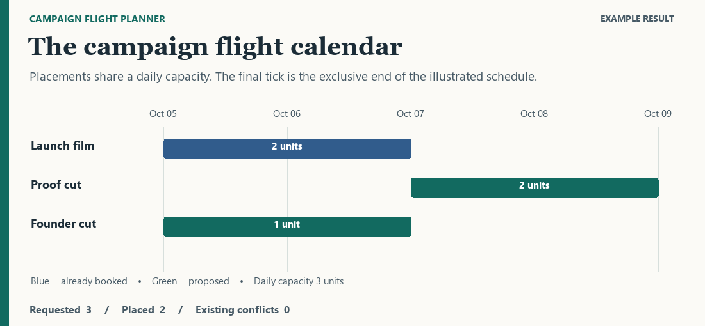
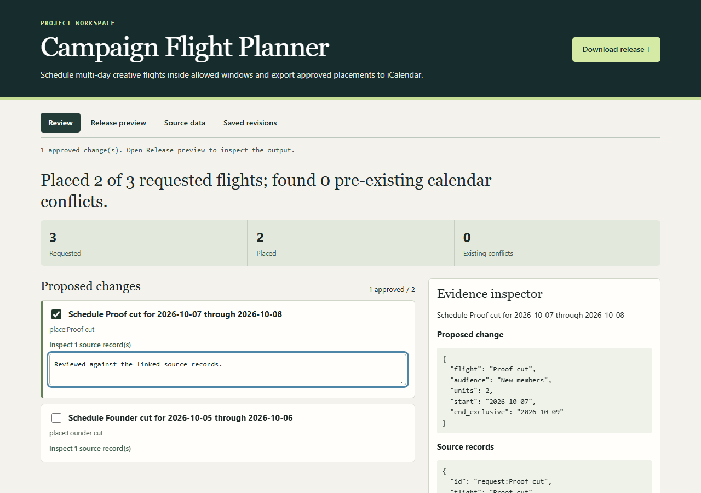

# Campaign Flight Planner

Schedule multi-day creative flights inside allowed windows and export approved placements to iCalendar.

**[Open the live demo](https://oguzhanozfe.github.io/campaign-flight-planner/)** · [](https://github.com/oguzhanozfe/campaign-flight-planner/actions/workflows/check.yml) · [Deploy to Render](https://render.com/deploy?repo=https://github.com/oguzhanozfe/campaign-flight-planner) · [Input guide](GUIDE.md)

Several creatives compete for the same audience on the same days. Fit flights into their permitted windows and hand the approved placements to a shared calendar.



The live demo lets you edit the input, search proposed changes with an on-device model and download the result. [Browser demo details](demo/DEMO.md)

## Try it

With Python 3.11+ installed, clone this repository and run:

```sh
git clone https://github.com/oguzhanozfe/campaign-flight-planner.git
cd campaign-flight-planner
python app.py
```

Open <http://127.0.0.1:8000>. The synthetic example is loaded. Select a proposed change, inspect its source records, and open **Release preview** to see the resulting files. Choose **Download release** to save them.

## Walk through the example

The input describes existing bookings and requested creative flights. A booking has an ID, audience, start date, duration in days and a daily capacity requirement in units. Requests give earliest start, latest **inclusive end**, duration, units and priority from one to five. A single daily-capacity limit applies across audiences.

**What the engine finds.** Placed 2 of 3 requested flights; found 0 pre-existing calendar conflicts.

**Try this decision.** Approve **Schedule Proof cut for 2026-10-07 through 2026-10-08**. The [example review](docs/example-review.json) lists the supporting record IDs and the checksum of each exported file. Its native outputs are [`creative-flights.ics`](docs/example-release/creative-flights.ics).

Reproduce that release at the command line:

```sh
python app.py analyze example.json
python app.py export example.json --approve "place:Proof cut" --out reviewed.zip
```

## Model-assisted review

With a local model in Ollama or LM Studio, Azure OpenAI, Amazon Bedrock, or a compatible API connected, select **Request suggestions**. The model examines up to eight candidate actions. Each displayed suggestion links to one of that action's source records. Approving a change and recording a review note remain explicit reviewer actions.

The app runs locally with Python's standard library. The Docker image includes the Bedrock SDK and the production web server. The same UI can save immutable revisions, reopen a workspace and compare decisions. See [model settings, Docker deployment and the HTTP API](docs/deployment.md).



## Development

The domain algorithm and exporter live in [pipeline.py](pipeline.py). The [method guide](GUIDE.md) describes its input assumptions and limitations. Install test dependencies and run the suite:

```sh
python -m pip install -r requirements.txt
python -m unittest discover -v
```

[MIT license](LICENSE)
